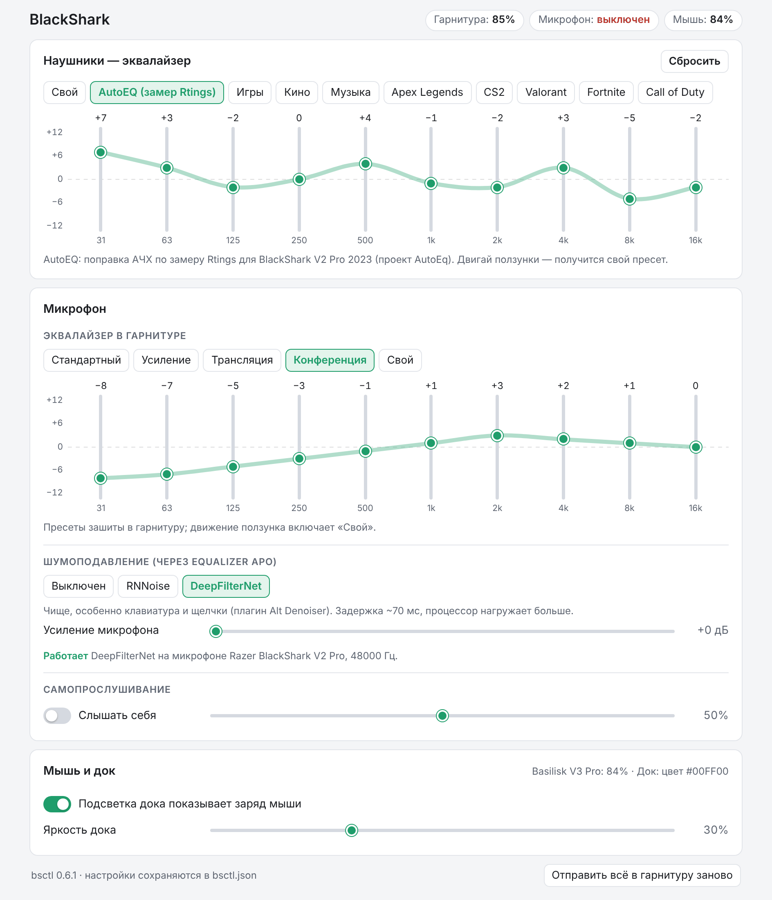

# bsctl — BlackShark V2 Pro, Basilisk V3 Pro и Mouse Dock Pro без Razer Synapse

Маленькая утилита для Windows на Go вместо Razer Synapse: значки в трее, окно настроек и консольные
команды для гарнитуры **Razer BlackShark V2 Pro (2023)**, мыши **Basilisk V3 Pro** и зарядной станции
**Mouse Dock Pro**. Без драйверов, без CGO и без сервисов Razer. Из зависимостей Go только `golang.org/x/sys`.

<picture>
  <source media="(prefers-color-scheme: dark)" srcset="docs/settings-dark.png">
  
</picture>

## Что умеет

- **Трей:** два значка, наушники и мышь. Цвет показывает заряд, молния — зарядку, красный значок на наушниках — выключенный кнопкой микрофон.
- **Эквалайзер наушников** в самой гарнитуре: 10 полос от −12 до +12 дБ и пресеты Synapse.
  Есть пресет **AutoEQ**: поправка АЧХ по замеру Rtings для BlackShark V2 Pro 2023 (проект AutoEq).
- **Эквалайзер микрофона** через Equalizer APO: пресеты Стандартный, Усиление, Трансляция, Конференция и свои 10 полос.
  Собственный эквалайзер микрофона в гарнитуре команды принимает, но звук не меняет, поэтому он не используется.
- **Самопрослушивание** с регулировкой громкости. Оно работает, как в Synapse: пока включено, трей держит микрофон открытым.
- **Шумоподавление** во всех программах сразу через Equalizer APO. Движков два, **RNNoise** и **DeepFilterNet**.
  Переключаются в окне настроек или в меню трея.
- **Подсветка Mouse Dock Pro** показывает заряд мыши тем же цветом, что Synapse; пока мышь заряжается, свет «дышит».
- **Окно настроек** открывается как отдельное окно Edge и запоминает своё место и размер. Повторный клик выводит вперёд уже открытое окно.
- **Консольные команды** для всего перечисленного, плюс диагностика.

## Что нужно

- Windows 10/11 x64.
- Гарнитура BlackShark V2 Pro 2023 с донглом HyperSpeed (USB `1532:0555`). Мышь Basilisk V3 Pro подключается через Mouse Dock Pro, свой донгл или кабель.
- Microsoft Edge для окна настроек; без него окно откроется в браузере по умолчанию.
- Для шумодава: [Equalizer APO](https://sourceforge.net/projects/equalizerapo/). Для DeepFilterNet ещё нужен
  Microsoft Visual C++ Redistributable 2015–2022 x64, обычно он уже стоит.
- Razer Synapse должен быть закрыт: он сам управляет устройствами и перебивает настройки.

## Установка и обновление

1. Скачай `bsctl-setup-X.Y.Z.exe` со страницы [Releases](https://github.com/eyescreamxd/bsctl/releases) и запусти.
   Прав администратора не нужно: программа ставится в `%LOCALAPPDATA%\Programs\bsctl`, в меню «Пуск» появляется
   «BlackShark Tray». Установщик не подписан, поэтому SmartScreen попросит нажать «Подробнее» → «Выполнить в любом случае».
2. Галочка «Запускать трей при входе в Windows» в установщике включает автозапуск (ключ `HKCU\…\Run`), потом его
   переключает меню трея. Если exe переехал, трей сам поправит путь в этом ключе.
3. Обновления трей проверяет сам, раз в 6 часов. Когда выйдет новая версия, в меню наушников появится
   «Установить обновление X.Y.Z»: трей скачает установщик, сверит SHA-256, тихо поставит его и перезапустится.
4. Удаление — «Параметры → Приложения». Деинсталлятор убирает автозапуск и свои файлы из Equalizer APO
   (`bsctl.txt`, строку `Include: bsctl.txt`, плагины). Настройки остаются.

Настройки хранятся в `%LOCALAPPDATA%\bsctl\bsctl.json`, лог — там же в `bsctl.log`; оба файла создаются сами.
Исключение — портативная сборка: если рядом с exe лежит `bsctl.json`, настройки и лог живут рядом с exe,
а обновления не проверяются. Так работает сборка для разработки в `dist\`.

## Трей


| Значок | Что значит |
|---|---|
| Цвет наушников и заливка мыши | заряд: зелёный от 75%, жёлтый 50–74%, оранжевый 25–49%, красный меньше 25% |
| Молния | заряжается |
| Красный кружок с полоской | микрофон выключен кнопкой на гарнитуре |
| Серый | гарнитура выключена или мышь спит |

Левый клик по любому значку открывает окно настроек, правый — меню.

- **Меню наушников:** эквалайзер, шумодав (Выключен / RNNoise / DeepFilterNet), самопрослушивание и его громкость, «Применить настройки», «Перезапустить донгл», «Перезапускать донгл после сна», открыть `bsctl.json` и лог, автозапуск, выход.
- **Меню мыши:** подсветка дока, яркость, «Проверить заряд сейчас».

**Донгл после сна.** Иногда после сна донгл отвечает трею, но гарнитура к нему не подключается, пока его не переткнёшь.
Пункт «Перезапускать донгл после сна» один раз спрашивает UAC и создаёт задачу планировщика `\bsctl\DongleReset`.
Дальше трей сам перезапускает донгл через 30 секунд после пробуждения, если гарнитура не подключилась. Во время перезапуска
на несколько секунд останавливается служба звука Windows: иначе `audiodg.exe` не даёт перезапустить звуковую часть донгла.
Задача запускает только системные `cmd`, `net` и `pnputil` с ID донгла, файлы из папки программы с правами администратора
не выполняются. «Перезапустить донгл» без задачи спрашивает UAC каждый раз.

Если Windows спрятала значки под стрелку «^»: Параметры → Персонализация → Панель задач → Другие значки на
панели задач, там включи BlackSharkTray.

## Окно настроек

- **Наушники:** пресеты и 10 вертикальных ползунков с кривой. Любое движение ползунка сохраняет кривую как «Свой».
- **Микрофон:** пресеты эквалайзера и свои полосы (через Equalizer APO). Ниже шумодав, усиление микрофона и самопрослушивание.
- **Мышь и док:** подсветка по заряду и яркость дока.
- Внизу кнопка «Отправить всё в гарнитуру заново».

Окно — это страница с локального HTTP-сервера трея: `127.0.0.1`, случайный порт, случайный токен в адресе, проверка заголовка `Host`.
Трей открывает её в Edge с ключом `--app`, находит окно по заголовку и ставит туда, где оно было в прошлый раз
(поле `settingsWindow` в `bsctl.json`).

## Шумоподавление

Эквалайзеры и самопрослушивание работают внутри гарнитуры, а шумодав — это обработка звука на ПК. Чтобы она
действовала во всех программах сразу, плагин встраивается в звуковой тракт Windows через Equalizer APO.

**Настройка**

1. Установи Equalizer APO. В его Device Selector (`C:\Program Files\EqualizerAPO\DeviceSelector.exe`, в старых версиях `Configurator.exe`) отметь
   **только микрофон** Razer BlackShark V2 Pro на вкладке *Capture devices* и перезагрузись. Наушникам APO не нужен.
2. Выбери движок в окне настроек или в меню трея. Трей копирует плагин в `<Equalizer APO>\config\bsctl\`
   (служба звука не может читать профиль пользователя), записывает свой `bsctl.txt` и добавляет в `config.txt` одну строку
   `Include: bsctl.txt`. Остальное в `config.txt` он не трогает. Equalizer APO подхватывает изменения сразу, без перезагрузки.
3. Проверить можно в Параметры → Система → Звук → микрофон → «Начать проверку» или тестом микрофона в Discord.

**Движки**

Ниже замер на синтезированной речи с шумом; плагины подключены так же, как их подключает Equalizer APO.

| | RNNoise | DeepFilterNet |
|---|---|---|
| Плагин | [werman/noise-suppression-for-voice](https://github.com/werman/noise-suppression-for-voice) v1.10 | [Alt Denoiser](https://github.com/Altinus/Alt-Denoiser) v1.0.3 (DeepFilterNet3) |
| Клавиатура в паузах | −25 дБ | −57 дБ |
| Клавиатура поверх речи, сигнал/шум | 0 → 10,7 дБ | 0 → 15,7 дБ |
| Вентилятор в паузах | глушит полностью (−87 дБ) | −18 дБ |
| Вентилятор поверх речи, сигнал/шум | 5 → 11 дБ | 5 → 13,2 дБ |
| Задержка | ~20 мс | ~70 мс |
| Требования | формат микрофона 48000 Гц | VC++ 2015–2022 x64 |

Плагин DeepFilterNet рассчитан на стерео и усредняет оба входа, а Equalizer APO на моно-микрофоне подаёт во второй вход тишину.
Из-за этого голос стал бы на 6 дБ тише, поэтому трей ставит перед плагином `Preamp: 6.02 dB`.

**Если что-то не так**

- *Пропал звук после установки Equalizer APO.* В Device Selector сними все галочки на *Playback devices*. У микрофона
  включи *Troubleshooting options* и сними *Use original APO*. Перезагрузись. Если не помогло, удали Equalizer APO и перезагрузись.
- *Окно пишет, что APO не подключён к микрофону.* После смены драйвера, например после удаления THX/Synapse,
  APO придётся отметить в Device Selector ещё раз.
- *Микрофон замолчал с DeepFilterNet.* Переключи на «Выключен» или RNNoise. `bsctl eapo` покажет, что нашёл трей.

## Командная строка

```
bsctl probe | status | apply             связь с донглом, состояние, отправить настройки
bsctl eq <пресет> | eq 0,0,1,2,...       эквалайзер: custom autoeq game movie music apex csgo valorant fortnite cod
bsctl miceq <пресет|полосы>              эквалайзер микрофона (APO): default micboost broadcast conference или 10 полос
bsctl sidetone on|off [0-100]            самопрослушивание
bsctl monitor [сек]                      записать события гарнитуры в лог
bsctl eapo                               Equalizer APO: микрофон, формат, плагины, конфиги (только чтение)
bsctl ns on|off [дБ] | ns rnnoise|dfn    шумодав и доп. усиление
bsctl mouse | mouse-monitor [сек]        мышь и док: заряд, прошивки, события
bsctl dock test|battery|RRGGBB|breath RRGGBB|spectrum|off|bright N|mode 0|3
bsctl tray | autostart on|off            трей; автозапуск
bsctl dongle-reset [on|off]              перезапустить донгл; on/off — задача для перезапуска после сна
```

Полоски эквалайзера идут по частотам 31, 63, 125, 250, 500, 1k, 2k, 4k, 8k и 16k Гц, значения от −12 до 12 дБ.

## Настройки: `bsctl.json`

| Ключ | По умолчанию | Что это |
|---|---|---|
| `preset` | `custom` | пресет наушников: `custom autoeq game movie music apex csgo valorant fortnite cod` |
| `customEQ` | десять нулей | свои 10 полос, дБ |
| `micPreset` | `3` | эквалайзер микрофона: 0 стандартный, 1 усиление, 2 трансляция, 3 конференция, 255 свой |
| `micCustomEQ` | десять нулей | свои полосы микрофона |
| `sidetone`, `sidetoneLevel` | `false`, `50` | самопрослушивание и громкость, % |
| `sidetoneKeepMicOpen` | `true` | держать микрофон открытым, пока включено самопрослушивание (без этого гарнитура молчит) |
| `autoPowerOffMinutes` | `0` | автовыключение гарнитуры, 0 — никогда |
| `remoteMode` | `true` | переводить донгл в режим управления с ПК перед командами |
| `pollSeconds`, `reapplyMinutes` | `5`, `0` | опрос гарнитуры; принудительная переотправка настроек, 0 — только когда нужно |
| `noiseSuppression.enabled`, `.engine`, `.micGainDb` | `false`, `rnnoise`, `0` | шумодав, движок (`rnnoise` или `deepfilternet`), доп. усиление |
| `mouse.enabled`, `.pollSeconds` | `true`, `30` | значок мыши и частота опроса заряда |
| `mouse.dockLighting`, `.dockBrightness` | `true`, `30` | подсветка дока по заряду и яркость, % |
| `mouse.dockRedWhenMouseOff` | `false` | красить док в красный, когда мышь спит, как Synapse |
| `settingsWindow` | — | место окна настроек, трей пишет его сам |
| `devicePath`, `useSetOutputReport` | — | найденный путь к донглу, служебное |

Трей перечитывает файл, если его поменяли вручную.

## Сборка

Нужен Go 1.26 или новее. На Windows запусти `scripts\build.cmd`: он соберёт `dist\bsctl.exe` и
`dist\BlackSharkTray.new.exe` и положит рядом плагины, скрипты и `README.txt`. Или вручную:

```
set CGO_ENABLED=0
go build -trimpath -ldflags "-s -w" -o dist\bsctl.exe ./cmd/bsctl
go build -trimpath -ldflags "-s -w -H=windowsgui -X main.defaultMode=tray" -o dist\BlackSharkTray.new.exe ./cmd/bsctl
```

С Linux или macOS собирается так же, с `GOOS=windows GOARCH=amd64`. Тесты протокола, конфигов Equalizer APO и окна настроек
не требуют Windows: `go test ./...`. Код под Windows проверяется командой `GOOS=windows go vet ./...`.

Сборка в `dist\` портативная: `build.cmd` кладёт туда `bsctl.json`, если его нет. Запуск — `dist\update.cmd`.

Проверки перед выпуском — `scripts\check.cmd`: `gofmt`, `go vet` и `go test` для Windows, `go vet` и сборка для Linux,
[staticcheck](https://staticcheck.dev) v0.8.2 для обеих систем.

**Выпуск версии.** Подними версию в `internal/version/version.go` и в первой строке `README.txt`, закоммить и
запушь тег: `git tag v0.8.0 && git push origin v0.8.0`. Workflow `release` проверит, что тег совпадает с версией,
прогонит проверки, соберёт exe и `bsctl-setup-0.8.0.exe` (Inno Setup) и создаст GitHub Release с установщиком и `.sha256`.
Ручной запуск workflow (Actions → release → Run workflow) собирает установщик только как артефакт, без релиза.

## Как устроено

| Путь | Что |
|---|---|
| `cmd/bsctl/` | `main`: консольные команды и диагностика; трей — та же программа с `-X main.defaultMode=tray` |
| `internal/headset/` | протокол гарнитуры (64-байтные HID-отчёты донгла), пресеты, поток событий, `Apply` |
| `internal/razer/` | протокол Razer 2.5 (90-байтные feature-отчёты): мышь через док, подсветка дока |
| `internal/hid/` | HID через `hid.dll` и CfgMgr32 |
| `internal/tray/`, `internal/wintray/`, `internal/icon/` | логика опроса и меню, свой трей на Win32, значки рисуются кодом |
| `internal/ui/` (+ `web/index.html`), `internal/tray/` | окно настроек: HTTP-сервер и страница; связь с треем и место окна |
| `internal/eapo/` | Equalizer APO: `bsctl.txt`, движки шумодава, формат микрофона через MMDevice API |
| `internal/audio/` | держит микрофон открытым для самопрослушивания (winmm) |
| `internal/config/`, `internal/paths/`, `internal/version/` | `bsctl.json` и лог, папки программы и состояния, версия |
| `internal/autostart/` | автозапуск через `HKCU\…\Run` |
| `internal/donglereset/` | перезапуск донгла: задача планировщика (`cmd`, `net`, `pnputil`), запуск с UAC |
| `internal/update/` | проверка релизов на GitHub, скачивание установщика с проверкой SHA-256 |
| `installer/bsctl.iss` | установщик Inno Setup: `%LOCALAPPDATA%\Programs\bsctl`, без прав администратора |
| `.github/workflows/release.yml` | релиз по тегу `vX.Y.Z`: проверки, сборка, установщик, GitHub Release |
| `third_party/rnnoise/`, `third_party/dfn/` | готовые VST2-плагины шумодава с лицензиями |
| `scripts/` | сборка, проверки, `update.cmd` и диагностические скрипты |
| `dist/` | результат сборки, в git не хранится |

**Гарнитура.** Донгл принимает 64-байтные отчёты. Пары команд «get/set»:

| Get / Set | Что |
|---|---|
| 0x13 / 0x93 | индекс пресета EQ |
| 0x15 / 0x95 | свой EQ |
| 0x16 / 0x96 | пресет EQ микрофона |
| 0x17 / 0x97 | свой EQ микрофона |
| 0x18 / 0x98 | самопрослушивание вкл/выкл |
| 0x19 / 0x99 | громкость самопрослушивания |
| 0x1D / 0x9D | группа пресетов |
| 0x1E / 0x9E | флаг пресета EQ динамиков |
| 0x2C / 0xAC | автовыключение |
| 0x55 / 0xE9 | микрофон вкл/выкл |
| 0x20 | связь (только чтение) |
| 0x21 | заряд (только чтение) |
| 0x2A | зарядка (только чтение) |

Уведомления приходят с тем же кодом и `op1 = 2`, например кнопка микрофона: `55 02 01 xx`.

Перед командами донгл переводится в режим управления с ПК. Опрос каждые несколько секунд служит заодно keep-alive.
Если донгл сбросил настройки, это видно по флагу 0x1E, и трей отправляет их заново.

**Мышь и док.** Протокол Razer 2.5: 90-байтный feature-отчёт, контрольная сумма — XOR байтов 2..87.

| Команда | Что |
|---|---|
| `07/80` | заряд |
| `07/84` | зарядка |
| `0F/02` | эффект подсветки |
| `0F/04` | яркость |
| `00/84`, `00/04` | режим устройства (чтение / запись) |

Мышь отвечает через док. Док сам присылает события входным отчётом 5: заряд, зарядка, сон мыши.

## Ограничения

- Эквалайзер микрофона в самой гарнитуре (пресеты 0x96 и полосы 0x97) прошивка подтверждает, но звук не меняется.
  Поэтому трей держит в гарнитуре пресет 0, а эквалайзер микрофона делает Equalizer APO. Без APO он не работает.
- Шумодав и эквалайзер микрофона не слышны в самопрослушивании: оно идёт внутри гарнитуры, мимо Windows.
  Проверять их надо записью или у собеседника.
- Пока работает Synapse, трей уступает ему устройства. Вместе их лучше не запускать.
- Задержка DeepFilterNet около 70 мс. На самопрослушивание она не влияет: оно идёт внутри гарнитуры.

## Сторонние компоненты и лицензии

| Компонент | Лицензия | Где |
|---|---|---|
| [golang.org/x/sys](https://pkg.go.dev/golang.org/x/sys) | BSD-3-Clause | зависимость Go |
| [AutoEq](https://github.com/jaakkopasanen/AutoEq) | MIT | кривая пресета AutoEQ |
| [noise-suppression-for-voice](https://github.com/werman/noise-suppression-for-voice) (RNNoise VST) | GPL-3.0 | `third_party/rnnoise/`, неизменённый бинарник |
| [Alt Denoiser](https://github.com/Altinus/Alt-Denoiser) (VST2, JUCE) | GPL-3.0 | `third_party/dfn/`, неизменённый бинарник |
| [DeepFilterNet](https://github.com/Rikorose/DeepFilterNet) | MIT / Apache-2.0 | модель внутри `third_party/dfn/alt_denoiser.dll` |

Тексты лицензий и контрольные суммы лежат рядом с плагинами (`README.txt`, `LICENSE*.txt`). Плагины работают как отдельные
программы внутри Equalizer APO, `bsctl` с ними не линкуется.

Сам `bsctl` распространяется под [WTFPL v2](LICENSE).

Проект не связан с Razer Inc. Razer, BlackShark, Basilisk и HyperSpeed — товарные знаки Razer Inc.
